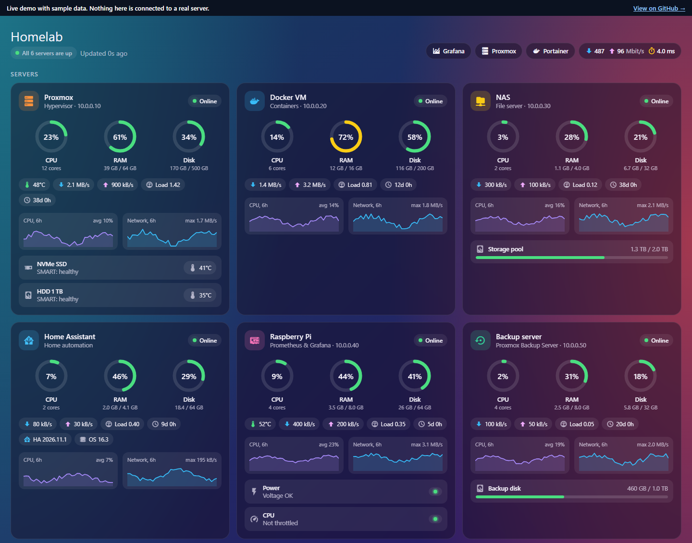
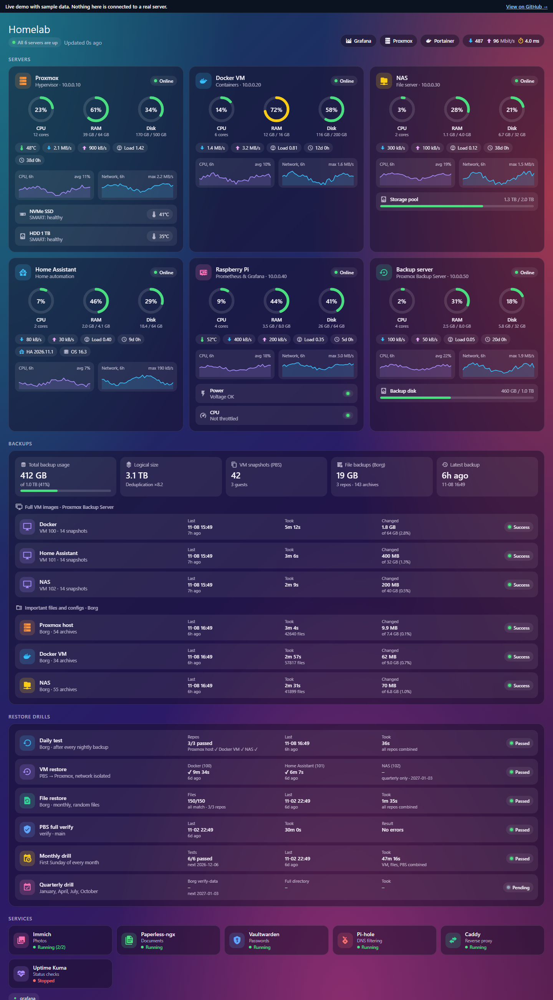

# Homelab Server Card for Home Assistant

[](https://hacs.xyz/docs/faq/custom_repositories)
[](https://github.com/Vilibera/ha-homelab-server-card/releases)
[](https://github.com/Vilibera/ha-homelab-server-card/releases)
[](LICENSE)

A single-file, dependency-free Lovelace card that turns Home Assistant into a **homelab dashboard**. It shows every server, its backups and its services on one page, using data you probably already have in **Prometheus**.

**[▶ Live demo with sample data](https://vilibera.github.io/ha-homelab-server-card/docs/)**



## Features

- **Servers**: CPU / RAM / disk gauges, temperature, network throughput, load and uptime, with 6-hour sparklines for CPU and network. All of it comes from `node_exporter` through Prometheus.
- **Disk health**: SMART status and temperature for NVMe and SATA drives (`smartmon` textfile collector).
- **Raspberry Pi**: undervoltage and throttling flags.
- **Home Assistant VM**: Supervisor API + System Monitor. No exporter needed.
- **Backups**:
  - Proxmox Backup Server: datastore usage, deduplication ratio, last snapshot per VM, changed bytes.
  - Borg: one row per repo, archive count, changed bytes.
- **Restore drills**: daily, monthly and quarterly restore tests. A backup counts only after it has been restored at least once.
- **Services**: container status from the Portainer integration, matched to your apps by regex.
- **Internet speed** chip from the Speedtest.net integration.
- Responsive layout that works in the companion app. It respects `prefers-reduced-motion` and refreshes itself when you deploy a new version.

<details>
<summary>Full-page screenshot (backups, restore drills, services)</summary>


</details>

## Installation

### HACS (recommended)
1. HACS → ⋮ → **Custom repositories** → add `https://github.com/Vilibera/ha-homelab-server-card`, type **Dashboard**.
2. Install **Homelab Server Card** and reload the browser.

### Manual
1. Download `homelab-server-card.js` from the [latest release](https://github.com/Vilibera/ha-homelab-server-card/releases/latest).
2. Copy it to `config/www/`.
3. Settings → Dashboards → ⋮ → **Resources** → add `/local/homelab-server-card.js` as a **JavaScript module**.

## Setup

### 1. Prometheus REST sensors
The card reads Prometheus query results that REST sensors store as attributes. Copy [`examples/rest_sensors.yaml`](examples/rest_sensors.yaml) into your config, replace `PROMETHEUS_URL` with your Prometheus address and include it:

```yaml
# configuration.yaml
rest: !include rest_sensors.yaml

recorder:
  exclude:
    entity_globs:
      - sensor.homelab_*   # big attributes, no need to keep history
```

Adjust the `mountpoint` and `device` regexes in the queries to match your machines.

### 2. The card
Use a **panel** view so the card gets the full width. A complete example is in [`examples/dashboard.yaml`](examples/dashboard.yaml). Minimal config:

```yaml
type: custom:homelab-server-card
metrics: sensor.homelab_metrics
cpu_history: sensor.homelab_cpu_history
net_history: sensor.homelab_network_history
hosts:
  - name: Proxmox
    role: Hypervisor
    instance: "10.0.0.10:9100"   # Prometheus `instance` label
    icon: server
    color: "#fb923c"
```

### Options

| Option | Description |
|---|---|
| `metrics` | **Required.** REST sensor with the main metrics query. |
| `cpu_history`, `net_history` | REST sensors with 6 h range queries for the sparklines. |
| `hosts` | List of servers. See host options below. |
| `backups` | REST sensor with `pbs_*` / `homelab_borg_*` metrics. Enables the Backups section. |
| `backup_max_age_h` / `borg_max_age_h` | When a backup counts as outdated (default 36 / 26). |
| `borg_repos` | `repo-label: { name, icon, color }`. Repos listed here appear even before their first backup. |
| `restore_vms` | `vmid: { name, quarterly }` for the VM restore drill row. |
| `drills` | `false` hides the Restore drills section. |
| `services` | `{ name, desc, icon, color, match }`. `match` is a regex tested against Portainer container names. |
| `portainer_url` | Shown in the hints when Portainer is not connected or down. |
| `speedtest` | `{ download, upload, ping }` entity ids. |
| `links` | `{ name, url, icon }` chips in the header. |

**Host options:** `name`, `role`, `ip`, `instance`, `icon`, `color`, `disks` (`{ name, dev, chip?, icon }`), `storage` (`{ "/mount": "Label" }`), `power: true` (Raspberry Pi flags), `backup: true` (the PBS host), `ha: true` + `sensors` (the Home Assistant VM), `pending: true` + `note` (placeholder for a server that has no metrics yet).

## Metrics reference
- **Hosts:** [`node_exporter`](https://github.com/prometheus/node_exporter); optional `smartmon` textfile collector; optional `rpi_undervoltage` / `rpi_throttling` gauges.
- **PBS:** `pbs_datastore_*`, `pbs_guest_*`, `pbs_backup_*` gauges with `store`, `type`, `id` and `name` labels.
- **Borg:** `homelab_borg_*` gauges with a `repo` label, for example `homelab_borg_backup_last_success`, `homelab_borg_backup_last_success_timestamp_seconds`, `homelab_borg_archives`, written by your backup script to the textfile collector.

## How it works
The card never contacts Prometheus directly. Home Assistant's REST integration runs the queries, so the browser needs no access to your network and no CORS setup. The card is plain vanilla JavaScript (a Web Component with a shadow DOM) in a single file, with no build step and no dependencies.

## Related
- [homelab-alerts-to-home-assistant](https://github.com/Vilibera/homelab-alerts-to-home-assistant): Alertmanager, Proxmox and Diun alerts as phone notifications through Home Assistant.

## License
MIT © Vilius B.
